# High-Resolution PM2.5 Web GIS Platform for Da Nang City (Unified)

Scientific Research Project: **NCKH T2026-02-DA2894.18**  
Last Updated: November 2026  

---

## 1. Purpose & Scope

### 1.1 Purpose
This interactive web GIS platform visualizes high-resolution daily ground-level particulate matter ($\text{PM}_{2.5}$) concentrations at a **1 km grid resolution** across the entire unified territory of **Da Nang City** from **January 1, 2023 to September 15, 2026 (1,354 continuous days)**.

The interface combines:
- Official brand identity icon mark (`logo.jpg` from `Logo/05_Original_Icon_Mark_1024x1024.jpg`) integrated into header badge, browser favicon, modal heads, and loading screen.
- Real satellite and vector map tiles (**Đường phố** and **Vệ tinh** powered by Google Maps).
- Dynamic atmospheric wind particle streamlines calculated from **ERA5 reanalysis** ($u_{10}, v_{10}$).
- CatBoost direct regression $\text{PM}_{2.5}$ raster layer with adjustable transparency.
- Dedicated monitoring station benchmarks: **Station NGLB (University of Science and Education – The University of Da Nang)** and **Station TAKY (Tam Ky)**.
- **Ultra-Fast Instant Loading Engine (<150ms)**: Native binary ArrayBuffers (`.bin`) and multi-threaded Python server (`ThreadingHTTPServer` + dual-stack IPv4/IPv6 support), eliminating previous socket stalls and Base64 CPU decoding overhead.

### 1.2 Scope & Spatial Unification
- **Geographical Domain**: Unified territory of Da Nang City strictly clipped according to the official administrative boundary shapefile (`Đà Nẵng (tỉnh thành) - 34.shp`).
- **Monitoring Stations (Official Exact Coordinates)**:
  - **Station NGLB (Đại học Sư Phạm)**: $16.061634^\circ\text{N}, 108.160351^\circ\text{E}$ (459 Ton Duc Thang, Lien Chieu, Da Nang).
  - **Station TAKY (Tam Kỳ)**: $15.5621^\circ\text{N}, 108.4867^\circ\text{E}$ (Tam Ky, Da Nang).
- **Temporal Span**: 1,354 consecutive days (2023–2026, from 2023-01-01 to 2026-09-15).

---

## 2. Architecture & Data Flow

```mermaid
flowchart TD
    subgraph Data_Inputs["Data Pipeline (01 - 07)"]
        S1["Ground Stations: NGLB & TAKY (Exact QC coordinates)"]
        S2["Satellite AOD Fusion: MODIS Terra/Aqua + VIIRS + CAMS"]
        S3["Meteorology: ERA5 Reanalysis (T, RH, Wind, BLH, U10, V10)"]
        S4["Precipitation: CHIRPS 0.05° Satellite Rainfall"]
        S5["Biomass Burning: NASA FIRMS 100/200/500 km Buffer"]
        S6["Official Boundary: Da Nang MultiPolygon Shapefile (34 units)"]
    end

    subgraph Modeling["Machine Learning Engine (Code/05_mo_hinh_cuoi.py)"]
        M1["CatBoost Direct Regressor (1000 trees, depth 5, R² = 0.697)"]
        M2["AOA Distance Index (Threshold DI = 0.342)"]
    end

    subgraph Storage["Output Storage (Ket_qua/)"]
        N1["NetCDF-4 CF-1.8: pm25_daily_1km.nc (83.3 MB)"]
        N2["Compressed Web Payloads: Gzip Base64 Binaries (web/data/*.txt)"]
        N3["Metadata Index: web/data/meta.json (with in_shp mask)"]
        N4["GeoJSON Boundary: web/data/danang_boundary.geojson"]
    end

    subgraph Client["Modern Interactive Frontend (web/index.html)"]
        C1["Leaflet 1.9.4 GIS Map Engine with Google Maps Tiles"]
        C2["Layer Dock: PM2.5 (CatBoost), Wind Particles (ERA5), AOA Mask"]
        C3["Official Vector Shapefile Clipping on HTML5 Canvas (evenodd)"]
        C4["Zoom-Adaptive Wind Particle Streamlines (Anti-Blur Engine)"]
        C5["Station Focus: Đại học Sư Phạm (NGLB) & Tam Kỳ (TAKY)"]
        C6["Draggable / Collapsible Point Drawer & 4-Year Sparkline Chart"]
        C7["Date Picker Range Validator & Toast Notification Alert"]
        C8["High-Performance Multi-threaded HTTP Pipeline"]
    end

    Data_Inputs --> Modeling
    Modeling --> Storage
    Storage --> Client
```



---

## 3. Usage & Execution Guide

### 3.1 Quick Launch (Windows)
Double-click `Mo_Web_PM25_DaNang.bat` in the project root:
```bat
Mo_Web_PM25_DaNang.bat
```
Or run via Python CLI:
```powershell
python chay_web.py
```

### 3.2 Interactive Controls & Keybindings
| Action | Interface Control | Keybinding |
|---|---|---|
| **Focus Station NGLB** | Header button `📍 Trạm NGLB (Sư Phạm)` | — |
| **Focus Station TAKY** | Header button `📍 Trạm TAKY (Tam Kỳ)` | — |
| **View Whole Province** | Header button `🌐 Toàn thành phố` | — |
| **Search Location** | Top-left search input pill (4,750+ Da Nang locations & OSM street geocoding) | — |
| **Switch Active Variable** | Layer Dock radio list (`PM2.5`, `Nhiệt độ`, `Độ ẩm`, `Gió`, `Mưa`, `BLH`) | — |
| **Date Selection** | Bottom timeline date input (`min="2023-01-01" max="2026-09-15"`) | Out-of-range Warning Toast |
| **Play / Pause** | Red circle Play button on bottom timeline | `Space` |
| **Step 1 Day** | Timeline scrubbing slider / Arrow keys | `Right` / `Left` |
| **Switch Basemap** | Layer Dock dropdown (`Đường phố` / `Vệ tinh`) | — |
| **Switch Color Palette** | Legend box dropdown (`Turbo` [Default], `QCVN 05`) | — |
| **Adjust Layer Opacity** | Layer Dock slider `Độ mờ lớp phủ` | — |
| **Toggle Wind Particles** | Layer Dock checkbox `Hạt gió (ERA5)` | — |
| **Toggle AOA Mask** | Layer Dock checkbox `Mặt nạ AOA` (Area of Applicability) | — |
| **Inspect Grid Cell** | Click any location on the map | — |
| **Zoom In / Out** | Zoom buttons `+` / `-` directly beneath Layer Dock (right side) | `+` / `-` or Scroll |
| **Resize Detail Drawer** | Drag top handle bar up/down (`↕ Kéo chỉnh độ cao`) | Drag / Touch |
| **Collapse / Expand Drawer** | Quick button `Thu gọn / Mở rộng` or double-click top handle | `DblClick` |
| **Close Detail Drawer** | Red close button `×` or click another point | `Escape` |

---

## 4. Scientific Methodology: Area of Applicability (AOA) vs AOD

### 4.1 Theoretical Foundation (Meyer & Pebesma 2021)
The model's reliability assessment is grounded in the peer-reviewed methodology of **Meyer & Pebesma (2021)** (*"Predicting into unknown space? Estimating the area of applicability of spatial prediction models"*, Methods in Ecology and Evolution, 12(9): 1620–1633):

1. **Weighted Feature Space ($Z$)**:
   Input covariates $X$ (meteorology, AOD, elevation, fire counts, etc.) are standardized by training mean ($\mu$) and standard deviation ($\sigma$), weighted by each feature's CatBoost importance weight ($w_j$):
   $$Z_j = \frac{X_j - \mu_j}{\sigma_j} \times w_j$$

2. **Dissimilarity Index ($DI$)**:
   For each $1\text{ km}$ grid cell at day $t$, the Dissimilarity Index measures the weighted Euclidean distance to the nearest training sample in feature space normalized by the mean pairwise training distance ($\bar{d}_{\text{train}} = 0.5098$):
   $$DI_{\text{new}} = \frac{\min_{i \in \text{train}} \| Z_{\text{new}} - Z_i \|}{\bar{d}_{\text{train}}}$$

3. **Threshold Determination via Leave-Location-Out (LLO)**:
   Cross-validation systematically withholds ground monitoring stations (evaluating NGLB vs TAKY). The threshold is established via the Tukey boxplot fence:
   $$DI_{\text{threshold}} = \max(DI_{\text{train}} \le Q_3 + 1.5 \times \text{IQR}) = 0.342$$

4. **In-Domain vs Out-of-Domain Classification**:
   - **Inside AOA ($DI \le 0.342$)**: Environmental conditions closely mirror ground training stations (coastal plains, urban zones). The model performs **interpolation** with high predictive accuracy. The UI leaves this region transparent so underlying $\text{PM}_{2.5}$ heatmaps are unobstructed.
   - **Outside AOA ($DI > 0.342$)**: Extreme high-elevation mountainous terrain (Nam Giang, Tay Giang, Phuoc Son) exhibits climatic and aerosol properties unseen in ground station training. The model performs **extrapolation**, marked with a dark warning mask to alert users of potential prediction uncertainty.

---

## 5. Technical Notes, Edge Cases & Gotchas

1. **Air-Urban Lab Brand Identity Architecture (Ellipse Badge & Floating Typography)**:
   - Extracted official vector-grade mark from `04_Original_Horizontal_Logo_Light_1376x768.jpg`:
     - Bridge icon is nestled inside an anti-aliased, pure-white elliptical badge with subtle drop-shadow (`box-shadow`), ensuring zero color clash with ocean blues or dark satellite basemaps.
     - Official brand typography (`AIR-URBAN LAB` + `Smart Construction & Atmospheric Intelligence - Da Nang`) has its white background completely removed (*transparent alpha channel*), enhanced with an anti-aliased light halo for 100% legibility over any map palette.
     - All ad-hoc "PM2.5 Đà Nẵng" placeholder text and pill wrapper borders have been completely removed.
   - **Optimized UI Hierarchy & Control Distribution**:
     - **Left Top (Tier 1)**: Station shortcut pills (\U0001f4cd Tr\u1ea1m NGLB, \U0001f4cd Tr\u1ea1m TAKY, \U0001f310 To\xe0n t\u1ec9nh).
     - **Left Top (Tier 2)**: Search box (T\xecm ki\u1ebfm \u0111\u1ecba \u0111i\u1ec3m...).
     - **Right Side (Dock Stack)**: Layer Dock (#layerDock) at top right, with zoom in/out controls (+ / -) positioned directly beneath it, perfectly aligned to its right edge.
   - Generates over 280px of clear horizontal breathing room around the center logo, preventing any control overlap across desktop and mobile screens.

2. **Comprehensive Da Nang Location Search & Bounded Geocoding Engine**:
   - Spatially indexed **4,750 real locations** strictly within the official Da Nang clipped boundary shapefile (`danang_locations.json`, 405 KB) across schools, universities, hospitals, clinics, pagodas, churches, markets, administrative wards, communes, and scenic attractions.
   - Accent-insensitive Vietnamese fuzzy matching (`stripVn`) for lightning-fast (<1ms) keystroke filtering.
   - Live hybrid fallback to Photon OpenStreetMap geocoding strictly bounded to the Da Nang bounding box ($107.15^\circ\text{E}$ to $108.80^\circ\text{E}$, $14.90^\circ\text{N}$ to $16.35^\circ\text{N}$) to discover specific street addresses and house numbers.
   - Selection triggers an animated `flyTo(zoom 14)` camera transition and automatically activates the 4-year $\text{PM}_{2.5}$ point analyzer drawer for the target grid cell.

3. **High-Performance Direct Canvas Layer Engine (Zero `toDataURL` Overhead)**:
   - Replaced Leaflet `L.ImageOverlay` PNG re-encoding with a native custom `CanvasBoundsOverlay` extending `L.Layer`.
   - Grid updates write directly to the hardware-accelerated canvas buffer in memory, reducing frame redraw latency from ~45 ms down to **< 0.4 ms** (<1% CPU).

3. **Precomputed 32-bit Color LUT & TypedArray Fast-Path**:
   - Palette color stops are precomputed into a 32-bit integer array (`pmLut32` in ABGR format).
   - In `paintDay()`, 9,861 grid cell colors are written directly to a `Uint32Array` buffer, followed by a single `putImageData()` call, bypassing 9,861 individual Canvas2D `fillRect()` operations.

4. **Precompiled `Path2D` Vector Boundary Mask**:
   - Official Da Nang administrative boundary geometry is parsed once at initialization into a native browser `Path2D` object.
   - Clipping is executed via `ctx.clip(daNangClipPath, 'evenodd')` with zero per-frame polygon parsing overhead.

5. **Screen-Space Wind Particle Streamlines (<1% CPU)**:
   - Wind particles move in screen-pixel space with an affine projection computed once per frame, eliminating over 72,000 geographic Mercator trigonometric calculations per second.

6. **Smooth RAF Timeline Scrubbing**:
   - Timeline pointer dragging separates thumb positioning (120 FPS instantaneous response) from map repainting via `requestAnimationFrame` debouncing, preventing event loop congestion.

7. **Shapefile-Based Administrative Boundary**:
   - Boundary coordinates are imported directly from the official Da Nang administrative shapefile (`Đà Nẵng (tỉnh thành) - 34.shp`).
   - Cells falling outside the shapefile polygon are flagged via `M.in_shp` and excluded from statistical calculations and inspector hits.

8. **Temporal Bounds & Validation Alert**:
   - The date input enforces `min="2023-01-01"` and `max="2026-09-15"`. Any manual entry outside this range triggers an immediate floating toast alert and resets to the nearest valid day.

9. **Station Coordinates (100% ExactQC Fixed)**:
   - Station NGLB (Đại học Sư Phạm): $16.061634^\circ\text{N}, 108.160351^\circ\text{E}$ (459 Ton Duc Thang, Lien Chieu, Da Nang).
   - Station TAKY (Tam Kỳ): $15.5621^\circ\text{N}, 108.4867^\circ\text{E}$ (Tam Ky, Da Nang).
   - Click highlight ring (`selCircle`) strictly targets the exact physical station coordinates rather than rounding to the $1\times 1\text{ km}$ raster cell centroid, eliminating dual visual target artifacts and aligning 100% with ground observations.

10. **Windy-Style Ultra-Slim Compact Drawer (`DEFAULT_DRAWER_HEIGHT = 270px`)**:
   - **Compact Aesthetic & Tight Line Spacing**: Redesigned table row heights (15-17px per row), compact font typography (9.5-10.5px), and sleek 38px sparkline canvas, mirroring the dense, professional meteogram aesthetic of Windy.com.
   - **Strict Height Clamping (`MAX_DRAWER_HEIGHT = 295px`)**: The drawer default height was compressed from 445px down to **270px** (a 175px reduction), liberating over 70% of screen height for the map basemap while framing all 10 time-series data rows down to BLH with zero vertical scrollbars and zero wasted white space.
   - **Deterministic Toggle Expansion**: Clicking "Thu gọn" collapses the drawer to a sleek 38px header bar (`.collapsed`). Clicking "Mở rộng" always restores directly to the 270px default height.

11. **Custom Map Pin Marker Icon (diem.png)**:
   - Replaced the generic yellow selection circle with the high-resolution location pin icon (diem.png, derived from E:\Documents\New\điểm.png).
   - Refined to a compact, non-intrusive GIS footprint of **22 × 26 px** with an exact bottom-tip anchor point at [11, 26] and popup anchor at [0, -26].
   - Tuned with a refined ambient drop-shadow (drop-shadow(0 2px 4px rgba(0, 0, 0, 0.65))), non-blocking pointer events (pointer-events: none), and instant rock-solid Leaflet coordinate locking without CSS transform lag.
